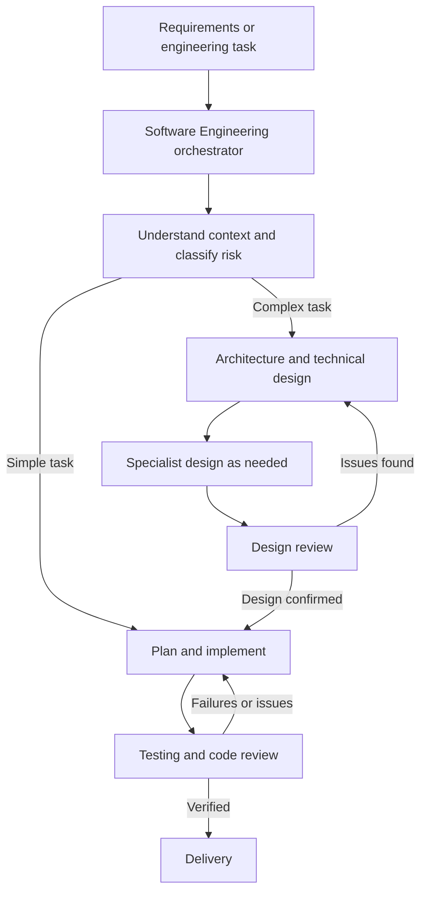
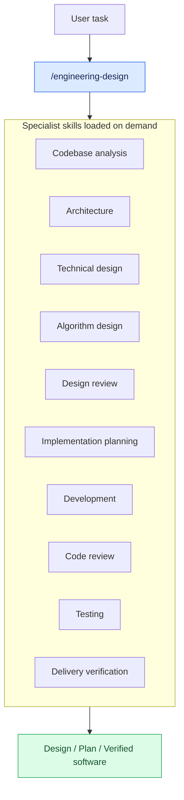
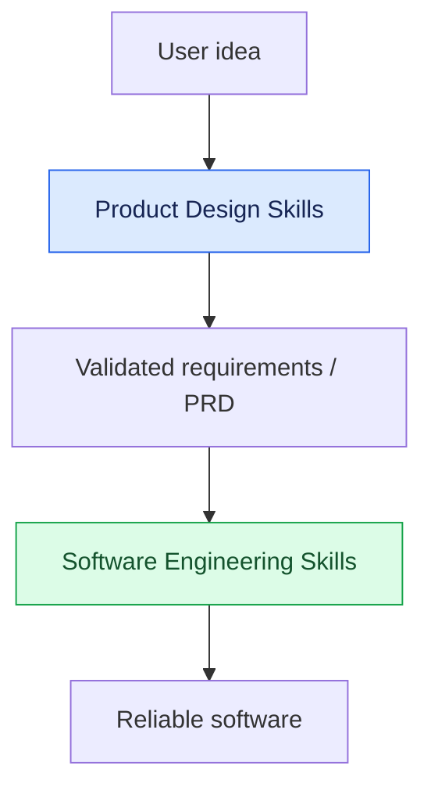

# Software Engineering Skills

[English](README.md) | [简体中文](README_zh.md)

**License:** [MIT](LICENSE)

**Professional AI skills for software architecture, design, development, testing, and delivery.**

An orchestrated [Agent Skills](https://agentskills.io/) toolkit for the software engineering lifecycle. Designed to help AI coding agents reason about systems, make explicit technical decisions, and deliver verified software instead of rushing from a feature request into code.

> Good software engineering is not just writing code. It is making the right decisions, managing trade-offs, and verifying the results.

## What ships today (important)

This repository publishes the orchestrator **plus companion specialists** (all MIT, part of this project):

| Shipped folder | Role |
| --- | --- |
| `engineering-design/` | Orchestrator |
| `algorithm-design/` | Algorithm-intensive design (not the paper/LaTeX skill of the same name elsewhere) |
| `technical-design-review/` | Skeptical design review |

These companions are **not** vendored copies of magnus919/mazrean/edhahn packs. True third-party skills (`software-architecture`, `writing-technical-design`, …) remain **optional** — see `engineering-design/references/installed-sources.md`.

After installing only this repo, run `scripts/check-skills` to see what is present vs fallback.

## Compatible agents

Skills in this repo follow the open **Agent Skills** format (`SKILL.md` + optional `references/` / `templates/`). Any host that loads that format can use them. Install the skill folder into the skills root your agent reads:

| Agent | User (global) skills root | Project skills root |
| --- | --- | --- |
| Claude Code | `~/.claude/skills/` | `.claude/skills/` |
| Codex | `~/.agents/skills/` (preferred); `~/.codex/skills/` (legacy) | `.agents/skills/` |
| Cursor | `~/.cursor/skills/` | `.cursor/skills/` |
| OpenClaw | `~/.openclaw/workspace/skills/` | workspace `skills/` |
| GitHub Copilot | `~/.copilot/skills/` | `.github/skills/` |
| Gemini CLI | `~/.gemini/skills/` | `.gemini/skills/` |
| OpenCode | `~/.config/opencode/skills/` | `.opencode/skills/` |
| Windsurf | `~/.codeium/windsurf/skills/` | `.windsurf/skills/` |
| Other Agent Skills hosts | Prefer `~/.agents/skills/` when documented | host-specific |

Use **one checkout**, then copy or symlink into each host you use. Prefer symlinks for local development so edits apply everywhere.

See also: [Agent Skills specification](https://agentskills.io/specification), [client showcase](https://agentskills.io/clients).

## Why Software Engineering Skills?

AI coding agents are effective at implementation, but complex features demand more than a short specification and a task checklist. Architecture boundaries, algorithm correctness, data contracts, failure handling, migration risks, and testability need deliberate design.

Software Engineering Skills bridges the gap between requirements and implementation with adaptive technical design, specialist reasoning, and quality gates throughout development.

## Core capabilities

| Capability | Purpose |
| --- | --- |
| Codebase analysis | Understand existing architecture, behavior, dependencies, and root causes. |
| Architecture design | Define system boundaries, module responsibilities, and dependencies. |
| Technical design | Specify interfaces, data flow, state, and failure handling. |
| Algorithm design | Define objectives, constraints, candidate algorithms, and edge cases. |
| Design review | Challenge assumptions, compare trade-offs, and identify design risks. |
| Implementation planning | Translate agreed designs into actionable, testable tasks. |
| Development | Implement changes within the approved design and project conventions. |
| Testing and debugging | Verify behavior, diagnose failures, and prevent regressions. |
| Code review and delivery | Review correctness, maintainability, and verification evidence. |

## How it works



The orchestrator selects specialist skills based on the engineering task, risk, and uncertainty. It keeps trivial changes lightweight while requiring deeper design and verification for complex or high-impact changes.

A design-only or review-only request stops at the requested deliverable; it does not automatically trigger implementation.

## Design principles

- **One entry point:** route work to relevant specialist skills without manually selecting each one.
- **Evidence-driven design:** ground decisions in real code, requirements, tests, and constraints.
- **Adaptive workflow:** scale the process to the complexity and risk of the task.
- **Progressive loading:** load only the specialist instructions needed for the current stage.
- **Explicit trade-offs:** document important decisions and rejected alternatives when relevant.
- **Quality gates:** identify design defects before coding and verify behavior before declaring completion.
- **Technology and domain agnostic:** support new and existing software across languages, frameworks, and platforms.
- **Composable:** reuse existing engineering workflows and tools rather than unnecessarily replacing them.

## Capability orchestration



## Third-party Skills and upstream projects

The following are candidate upstream sources, **not a verified installation manifest**. Check paths, current stars, maintenance, licensing, dependencies and safety before selecting. Prefer mature, relevant skills; avoid installing entire collections or duplicates.

| Upstream repository | Candidate capability / skill | Purpose | Status |
| --- | --- | --- | --- |
| [obra/superpowers](https://github.com/obra/superpowers) | brainstorming / writing-plans / TDD / review | Planning, implementation, testing and review | Candidate |
| [mblode/agent-skills](https://github.com/mblode/agent-skills) | codebase-architecture | Existing architecture and module boundaries | Candidate |
| [magnus919/agent-skills](https://github.com/magnus919/agent-skills) | software-architecture | Architecture decisions and review | Candidate |
| [edhahn/agent-skills](https://github.com/edhahn/agent-skills) | software-architecture | Technical specifications and interfaces | Candidate |
| [mazrean/agent-skills](https://github.com/mazrean/agent-skills) | writing-technical-design | Detailed technical design | Candidate |
| [github/awesome-copilot](https://github.com/github/awesome-copilot) | agent-architecture | Optional AI agent architecture | Candidate |
| [bmad-code-org/BMAD-METHOD](https://github.com/bmad-code-org/BMAD-METHOD) | architecture workflow | Architecture workflow reference | Candidate |

A release manifest should record each selected skill’s pinned commit, installation path and original license. The orchestrator and missing specialist capabilities are maintained by this project.

## Installation

Pick a **skills root** from the [Compatible agents](#compatible-agents) table, then install **all shipped folders** (orchestrator + companions).

### Recommended (scripts)

```bash
git clone https://github.com/neverwork-lab/software-engineering-skills.git
cd software-engineering-skills

# Choose ONE host root, e.g.:
#   export SKILLS_ROOT="$HOME/.claude/skills"
#   export SKILLS_ROOT="$HOME/.agents/skills"
#   export SKILLS_ROOT="$HOME/.cursor/skills"
#   export SKILLS_ROOT="$HOME/.openclaw/workspace/skills"

export SKILLS_ROOT="${SKILLS_ROOT:-$HOME/.agents/skills}"
chmod +x scripts/*.sh
./scripts/install-skills.sh
./scripts/check-skills.sh
```

```powershell
git clone https://github.com/neverwork-lab/software-engineering-skills.git
Set-Location software-engineering-skills
$env:SKILLS_ROOT = "$HOME\.agents\skills"
.\scripts\install-skills.ps1
.\scripts\check-skills.ps1
```

`install-skills` installs: `engineering-design`, `algorithm-design`, `technical-design-review`.

### Verify in the agent

1. Restart the agent / start a new session.
2. Invoke `/engineering-design` (or `/skill engineering-design`), or ask in natural language.
3. If discovery fails, ask the agent to read `engineering-design/SKILL.md` from the install path.

## Usage

Once installed, invoke the orchestrator, then describe the engineering task:

```text
/engineering-design
Design a plugin system for my existing desktop application.
Analyze the current architecture, compare options, and produce a technical design.
Do not implement it yet.
```

Other examples:

- Design and validate an algorithm for video shot selection and sequencing.
- Review this technical design for conflicting constraints and failure scenarios.
- Implement an approved feature, add regression tests, and review the changes.
- Diagnose a performance bottleneck and propose a measurable optimization plan.

### Repository structure

```text
software-engineering-skills/
├── README.md / README_zh.md / LICENSE / CONTRIBUTING.md
├── scripts/
│   ├── install-skills.{sh,ps1}
│   └── check-skills.{sh,ps1}
├── engineering-design/          # orchestrator
├── algorithm-design/            # shipped companion
└── technical-design-review/     # shipped companion
```

## Working with Product Design Skills and optional planners

[Product Design Skills](https://github.com/neverwork-lab/product-design-skills) is the companion toolkit for product discovery, requirements analysis, product design, and PRD creation.



The engineering toolkit accepts confirmed requirements or a clearly scoped technical task.

Optional planning / TDD / review skill packs (for example [Superpowers](https://github.com/obra/superpowers) when available on a given host) may collaborate **after** design gates pass. The orchestrator should not duplicate stages or invent a competing SDLC. Design works fully without those plugins.

## Roadmap

- [ ] Core orchestrator and adaptive task routing
- [ ] Curated architecture and technical design skills
- [ ] Algorithm design and independent review methods
- [ ] Implementation, testing, and verification workflows
- [ ] Design templates and reproducible workflow evaluations
- [ ] Install helpers (multi-host copy/symlink) and smoke checks
- [ ] Verify on Claude Code, Codex, Cursor, OpenClaw, and other Agent Skills hosts
- [ ] Document optional planner integrations per host (when present)

## Contributing

Contributions are welcome, especially real-world engineering cases, design review methods, failure scenarios, and reproducible evaluations. Prefer practical engineering improvements over unnecessary abstractions or process overhead.

## Credits and license

This project is released under the [MIT License](LICENSE). Copyright (c) 2026 neverwork-lab.

Third-party skills you install separately keep their original licenses. See [THIRD_PARTY_NOTICES.md](THIRD_PARTY_NOTICES.md) and `engineering-design/references/installed-sources.md`.

Contribution guide: [CONTRIBUTING.md](CONTRIBUTING.md).

Part of the **neverwork-lab** open-source series.
