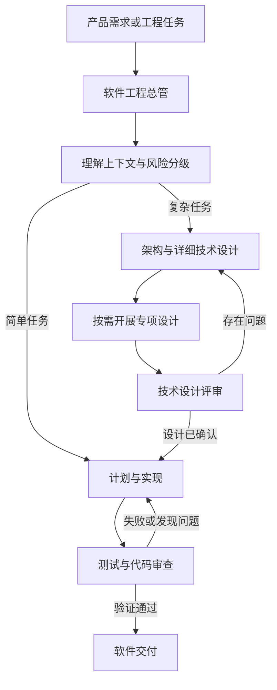
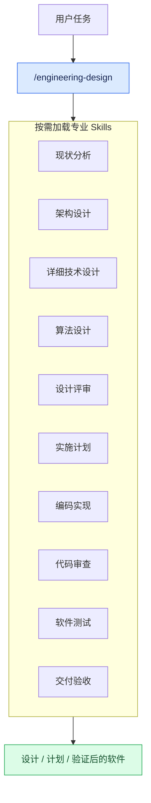
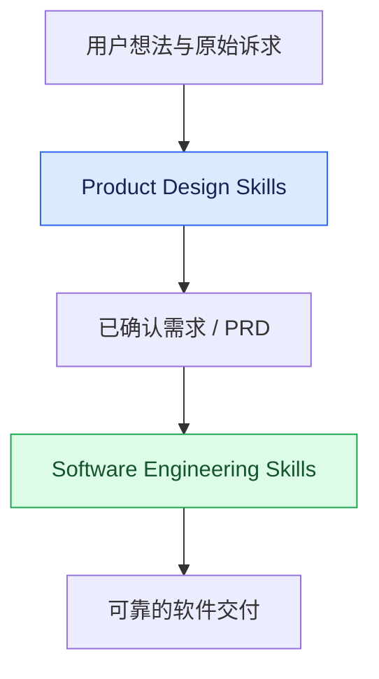

# Software Engineering Skills · 软件工程

[English](README.md) | [简体中文](README_zh.md)

**许可证：** [MIT](LICENSE)

**覆盖软件架构、设计、开发、测试和交付的专业 AI Skills。**

一套覆盖软件工程生命周期的 [Agent Skills](https://agentskills.io/) 编排体系。旨在帮助 AI 编程助手理解系统、明确技术决策、交付经过验证的软件，而不是从功能诉求直接跳到编码。

> 优秀的软件工程不仅是编写代码，更是作出合理的技术决策、管理取舍，并验证最终结果。

## 当前实际交付（重要）

本仓库发布**总管 + 配套专项**（均为本仓库 MIT 内容）：

| 目录 | 角色 |
| --- | --- |
| `engineering-design/` | 总管 |
| `algorithm-design/` | 算法密集型设计（与别处同名的论文/LaTeX skill 不是同一份） |
| `technical-design-review/` | 技术设计评审 |

这些配套专项**不是** magnus919/mazrean/edhahn 等包的直接拷贝。真正的第三方架构/设计 skill 仍为**可选**——见 `engineering-design/references/installed-sources.md`。

安装后请运行 `scripts/check-skills` 查看已安装项与降级提示。

## 兼容的 Agent

本仓库遵循开放的 **Agent Skills** 格式（`SKILL.md` + 可选的 `references/` / `templates/`）。凡支持该格式的宿主均可使用。将 skill 目录安装到对应 Agent 的 skills 根目录：

| Agent | 用户级（全局）目录 | 项目级目录 |
| --- | --- | --- |
| Claude Code | `~/.claude/skills/` | `.claude/skills/` |
| Codex | `~/.agents/skills/`（推荐）；`~/.codex/skills/`（旧） | `.agents/skills/` |
| Cursor | `~/.cursor/skills/` | `.cursor/skills/` |
| OpenClaw | `~/.openclaw/workspace/skills/` | 工作区 `skills/` |
| GitHub Copilot | `~/.copilot/skills/` | `.github/skills/` |
| Gemini CLI | `~/.gemini/skills/` | `.gemini/skills/` |
| OpenCode | `~/.config/opencode/skills/` | `.opencode/skills/` |
| Windsurf | `~/.codeium/windsurf/skills/` | `.windsurf/skills/` |
| 其他 Agent Skills 宿主 | 文档未指定时优先 `~/.agents/skills/` | 以宿主文档为准 |

建议只保留**一份检出**，再按需复制或符号链接到各宿主目录；本地开发优先用 symlink，改一处处处生效。

参考：[Agent Skills 规范](https://agentskills.io/specification)、[客户端一览](https://agentskills.io/clients)。

## 为什么需要 Software Engineering Skills？

AI 编程助手擅长实现功能，但复杂需求不能仅依靠一份简单规格说明和任务清单。架构边界、算法正确性、数据契约、异常处理、迁移风险和可测试性，都需要经过充分设计。

Software Engineering Skills 通过动态适配的技术设计、专业分析与质量门禁，填补需求与实现之间的工程设计空缺，并贯穿开发过程。

## 核心能力

| 能力 | 职责 |
| --- | --- |
| 现有系统分析 | 理解现有架构、行为、依赖与问题根因。 |
| 软件架构设计 | 明确系统边界、模块职责及依赖关系。 |
| 详细技术设计 | 定义接口、数据流、状态及异常处理。 |
| 算法设计 | 明确目标、约束、候选算法及边界条件。 |
| 技术设计评审 | 质疑假设、比较方案取舍、识别设计风险。 |
| 实施计划 | 将已确认的设计转化为可执行、可测试的任务。 |
| 软件开发 | 在已确认设计及项目规范下实现功能。 |
| 测试与调试 | 验证行为、定位问题、预防回归。 |
| 代码审查与交付 | 检查正确性、可维护性及验证证据。 |

## 工作原理



总管根据工程任务、风险和不确定性选择专业 Skills。简单修改保持轻量，复杂或高影响任务进行更深入的设计和验证。

如果用户仅要求设计或评审，则在指定交付物处结束，不自动进入编码阶段。

## 设计原则

- **统一入口：** 自动调度相关专业 Skills，不需要手动选择每个技能。
- **基于证据的设计：** 依据真实代码、需求、测试与约束作出决策。
- **动态工作流：** 根据任务复杂度和风险调整流程。
- **渐进式加载：** 只加载当前阶段需要的专业指令。
- **明确技术取舍：** 必要时记录重要决策及放弃其他方案的理由。
- **质量门禁：** 编码前发现设计缺陷，交付前验证软件行为。
- **技术栈与领域无关：** 支持不同语言、框架、平台的新项目与存量项目。
- **可组合协作：** 优先复用已有工程流程及工具，而不是不必要地替换它们。

## 能力编排图



## 第三方 Skills 与上游项目

以下是拟筛选的上游来源，**不是已安装清单**。安装前需核实 Skill 路径、当前 Star 数、维护状态、许可证、依赖和安全性。优先成熟且匹配任务的项目；不整库安装，不重复安装。

| 上游仓库 | 候选能力 / Skill | 用途 | 状态 |
| --- | --- | --- | --- |
| [obra/superpowers](https://github.com/obra/superpowers) | brainstorming / writing-plans / TDD / review | 计划、开发、测试及审查 | 待验证 |
| [mblode/agent-skills](https://github.com/mblode/agent-skills) | codebase-architecture | 存量架构、模块边界 | 待验证 |
| [magnus919/agent-skills](https://github.com/magnus919/agent-skills) | software-architecture | 架构决策及评审 | 待验证 |
| [edhahn/agent-skills](https://github.com/edhahn/agent-skills) | software-architecture | 技术规格与接口设计 | 待验证 |
| [mazrean/agent-skills](https://github.com/mazrean/agent-skills) | writing-technical-design | 详细技术设计 | 待验证 |
| [github/awesome-copilot](https://github.com/github/awesome-copilot) | agent-architecture | AI Agent 专项设计（按需） | 待验证 |
| [bmad-code-org/BMAD-METHOD](https://github.com/bmad-code-org/BMAD-METHOD) | architecture workflow | 架构工作流参考 | 待验证 |

最终发布时将在依赖清单中记录选定 Skill 的固定 commit、安装路径和原始许可证。总管及缺失的专项能力由本项目维护。

## 安装

先从[兼容的 Agent](#兼容的-agent)表选定 **skills 根目录**，再安装本仓**全部已发布目录**（总管 + 配套专项）。

### 推荐（脚本）

```bash
git clone https://github.com/neverwork-lab/software-engineering-skills.git
cd software-engineering-skills
export SKILLS_ROOT="${SKILLS_ROOT:-$HOME/.agents/skills}"
chmod +x scripts/*.sh
./scripts/install-skills.sh
./scripts/check-skills.sh
```

```powershell
git clone https://github.com/neverwork-lab/software-engineering-skills.git
Set-Location software-engineering-skills
$env:SKILLS_ROOT = "$HOME\.agents\skills"
.\scripts\install-skills.ps1
.\scripts\check-skills.ps1
```

`install-skills` 会安装：`engineering-design`、`algorithm-design`、`technical-design-review`。

### 在 Agent 中验证

1. 重启 Agent / 新开会话。
2. 调用 `/engineering-design`（或 `/skill engineering-design`），或用自然语言。
3. 若未发现，显式要求读取安装路径下的 `engineering-design/SKILL.md`。

## 使用方式

安装后调用总管，再用自然语言描述工程任务：

```text
/engineering-design
为现有桌面软件设计一套插件系统。
分析当前架构，比较候选方案，并输出详细技术设计。
暂时不要编写业务代码。
```

其他使用示例：

- 设计并验证视频镜头选取与编排算法。
- 评审这份技术设计，检查约束冲突和异常场景。
- 实现已经确认的功能，补充回归测试并审查代码。
- 分析性能瓶颈，提出可量化验证的优化方案。

### 目录结构

```text
software-engineering-skills/
├── README.md / README_zh.md / LICENSE / CONTRIBUTING.md
├── scripts/install-skills.* 、 check-skills.*
├── engineering-design/
├── algorithm-design/
└── technical-design-review/
```

## 与 Product Design Skills 及可选计划类 Skills 协作

[Product Design Skills](https://github.com/neverwork-lab/product-design-skills) 是配套的产品发现、需求分析、产品设计与 PRD 编写能力体系。



软件工程体系既可以接收已确认的产品需求，也可以直接处理范围明确的技术任务。

可选的计划 / TDD / 审查技能包（例如在当前宿主上可用的 [Superpowers](https://github.com/obra/superpowers)）可在设计门禁通过后协作。总管不应重复阶段或发明另一套 SDLC。没有这些插件时，设计流程仍可独立完成。

## 路线图

- [ ] 核心总管及动态任务路由
- [ ] 精选架构与详细技术设计 Skills
- [ ] 算法设计与独立评审方法
- [ ] 开发、测试和验证工作流
- [ ] 设计模板及可复现的工作流评估
- [ ] 多宿主安装助手（复制 / 符号链接）与冒烟检查
- [ ] 在 Claude Code、Codex、Cursor、OpenClaw 及其他 Agent Skills 宿主上验证
- [ ] 按宿主记录可选计划类 Skills 集成说明

## 贡献

欢迎贡献真实工程案例、设计评审方法、异常场景及可复现的评估用例。优先解决实际工程问题，避免引入不必要的抽象和流程负担。

## 致谢与许可证

本项目采用 [MIT License](LICENSE)。Copyright (c) 2026 neverwork-lab。

你另行安装的第三方 Skills 仍受其原始许可证约束。详见 [THIRD_PARTY_NOTICES.md](THIRD_PARTY_NOTICES.md) 与 `engineering-design/references/installed-sources.md`。

贡献指南：[CONTRIBUTING.md](CONTRIBUTING.md)。

本项目属于 **neverwork-lab** 开源系列。
