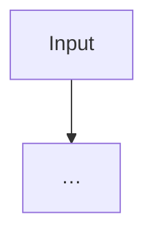

# Algorithm Design — {{title}}

- Status: draft | review | approved
- Date: YYYY-MM-DD
- Related design / issue: …

## 1. Problem model

- Goal:
- Non-goals:
- Decision variables:
- Objective(s) (primary / secondary):
- Success definition:

## 2. Inputs / outputs / constraints

### Inputs
| Name | Type / shape | Constraints | Source |

### Outputs
| Name | Type / shape | Guarantees |

### Preconditions / postconditions / invariants

### Hard constraints
1.

### Soft constraints (with penalty or preference)
1.

## 3. Candidate approaches

| Option | Idea | Pros | Cons | Complexity | Fit to existing code |
|--------|------|------|------|------------|----------------------|
| A | | | | | |
| B | | | | | |
| C | | | | | |

**Recommendation:** …  
**Rejected because:** …

## 4. Scoring / parameters

| Signal / weight | Role | Default | Rationale | Tunable? |
|-----------------|------|---------|-----------|----------|

## 5. Algorithm flow



### Pseudocode

```text
function solve(input):
  …
  return output
```

## 6. Rule priority and conflict resolution

| Priority | Rule | Conflicts with | Resolution |
|----------|------|----------------|------------|

## 7. Worked examples

### Example 1 (typical)
- Input:
- Step-by-step:
- Output:

### Example 2 (edge / adversarial)
- Input:
- Expected behavior:

## 8. Complexity and resources

- Time:
- Space:
- Latency / throughput budget:
- Parallelism / batching notes:

## 9. Failure handling

| Failure | Detection | Action | Fallback | User-visible effect |
|---------|-----------|--------|----------|---------------------|

## 10. Determinism and stability

- Same input → same output? Exceptions:
- Ordering stability:
- Randomness / seeds:
- LLM involvement and constraints:

## 11. Quality metrics and tests

- Online / offline metrics:
- Fixtures:
- Property / invariant tests:
- Regression cases that must not regress:

## 12. Open questions

- [ ]
